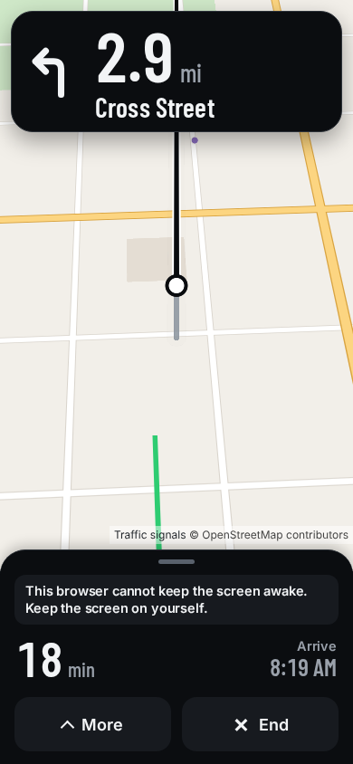
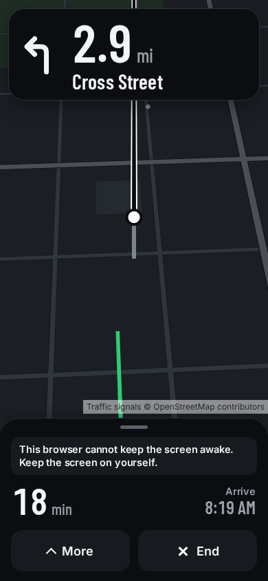
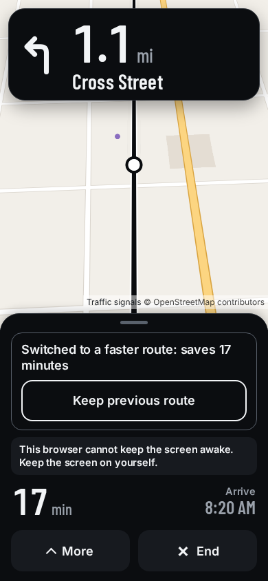
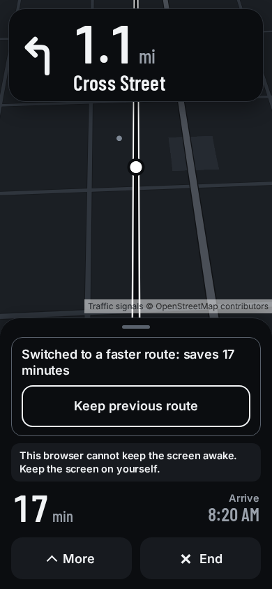

# The drive screen over a busy map, by day and by night (#47)

November 2026. Issue #47 asks whether the turn card, the sheet, the route line and the
switch markers stay legible over a real map, which is much busier than the mock-ups' hand-drawn
grid, and which Mapbox style settings the native app should use.

## How it was checked without a token

No Mapbox token exists in the cloud sessions, and Mapbox or OpenStreetMap stills may not
be committed to this public repo. So the e2e harness can now answer the map style request
with a **busy map of our own** (`e2e/world/busyMap.ts`, `Outside.mapStyle`). It is drawn by the
real mapbox-gl from inline GeoJSON:
- a dense street grid with major roads and a diagonal;
- parks, water and buildings;
- 1,400 points of interest;
- 260 stretches of red, orange and green traffic;
- a day palette and a night palette.

The geometry and the colours are our own, loosely in the range of a street map's. It is not
any product's style. It has no text labels, because those need a glyph server. `npm run
design:shots` photographs it (`busy map day`, `busy map night`) at 390x844, 430x932 and
844x390, during the e2e trip with the jam that leads to a switch. The Mapbox wordmark is hidden
in the pictures. The app always shows it.

What this cannot show: road and place labels behind the turn card, the exact colours of a
Mapbox style, and 3D buildings. Those still need a look on the phone with the real token.
Item 6 below lists what to look at.

| Day, driving | Night, driving | Day, after a switch | Night, after a switch |
|---|---|---|---|
|  |  |  |  |

The switch cards in these pictures are `main`'s (before #135). The amber stages of #135 sit in
the same sheet, so what is said here about the sheet applies to them.

## Findings

1. **The route line disappears into a night map (P1 at night).** The app draws the route
   ahead as a black core (`#0a0c0f`, 6 px) with a white casing (10 px), the day
   treatment. On a dark map the core is 1.2:1 against the land, so the route reads as two thin white
   rails with nothing between them (night pictures). The merged design's dark tokens already have the
   answer: a light core with a dark casing (`--route #f2f4f6`, `--case #050607`; 15:1 on
   a night land). **Fix:** the drive route's colours follow the map's light preset. That is
   two paint properties in `src/map/MapView.tsx`, keyed on the same day/night switch as the style.
2. **The glass loses its edge at night (P2).** The turn card and the sheet (`--glass
   #0b0d10`) are 1.17:1 against a night map's land, and the hairline (`--hair #2c3138`) is
   1.26:1. The shadow that lifts them by day does nothing on dark. The card still works,
   because its figures are white on black, but its edge and the sheet's top merge with the
   streets. **Fix:** over a night map, a lighter hairline of `#6b737e` (3.5:1 on the land,
   4.1:1 on the glass, the 3:1 a UI edge needs), 1.5 px. Keep `--hair` by day.
3. **Base-map traffic competes with the news colour (P2).** Red and orange traffic lines
   run under and beside the route (the green stretch in every picture). Orange is a
   neighbour of amber, which means "a faster route" and nothing else. RouteIQ already
   shows traffic where it matters, as the route's own slow stretch. **Fix:** the
   traffic layer is off on the drive map.
4. **Points of interest are noise at a glance (P3).** Even as small dots, they are the
   busiest thing behind the turn card and the route. While driving they help with nothing.
   **Fix:** POIs and transit off while driving. Keep them on the trip screen, where a
   destination is being looked for.
5. **Amber on a day map needs its casing (as designed).** Amber on a light land is 1.6:1,
   and the hollow pending ring is thinner than the branch. The design already gives the amber
   branch a black casing by day (design/README.md, "Daylight"). The map's turn marker has a
   dark stroke when filled but an amber stroke on white when pending. **Fix:** a 2 px dark
   outline around the pending ring by day. On a night map amber is 9:1 and needs nothing.
6. **Still to check on the phone with the real style:**
   - Road labels running under the turn card's lower edge. The card covers the top 150 px,
     so the camera's padding should keep the car and the next 300 m clear of it.
   - The attribution strip over dark land. It is light-on-dark in the pictures and fine.
   - The landscape layout, where the map is a thin strip today (#131).

## The Mapbox style note (for the web map and the native app)

| Setting | While driving | Trip screen | Why |
|---|---|---|---|
| Base style | Mapbox Standard with `lightPreset` `day` / `night`, or the navigation day / night styles | the same, day or night | one look for the whole app, made for roads |
| Day or night | from the phone's appearance (`prefers-color-scheme` on the web; the trait collection natively), later from sunset | the same | a white map at night is a torch in the driver's eyes |
| Points of interest | off (`showPointOfInterestLabels: false`) | on | noise at a glance; useful only when looking for a place |
| Transit labels | off | off | not a driver's concern |
| Road labels | on, default density | on | the street to turn onto has to match the turn card |
| Place labels | on | on | orientation |
| 3D buildings and landmarks | off | off | they hide the route at a low pitch and cost frames on the phone |
| Traffic layer | off | off | RouteIQ's own slow stretch says it; orange beside amber blurs "news" |
| Route ahead | day: core `#0a0c0f`, casing `#ffffff`; night: core `#f2f4f6`, casing `#050607` | (route list colours) | 17:1 and 15:1 against the land |
| Pending turn-off ring | amber with a 2 px dark outline by day | n/a | amber on a light map is 1.6:1 |

Each of these is a property of the style or one paint property. None of them adds work per
GPS fix: they are set when the map loads, and when the appearance changes.

## What comes next

- #145 for items 1 to 5 (web map; the native app takes the same table), with an e2e scenario that
  checks the style request asks for the night preset when the page is dark, and that the
  route paint follows it. The busy map makes that check possible offline.
- Re-photograph after #135 and #144 land (`npm run design:shots -- -g "busy map"`), and
  once on the phone with the real token for item 6.
