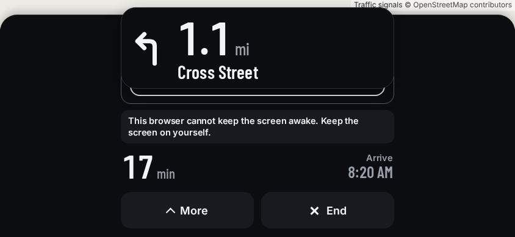
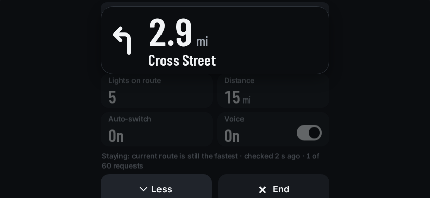
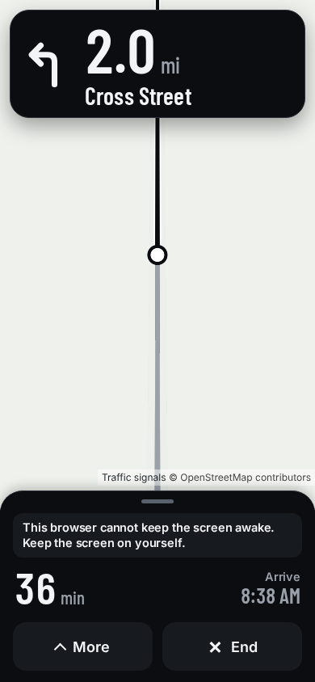
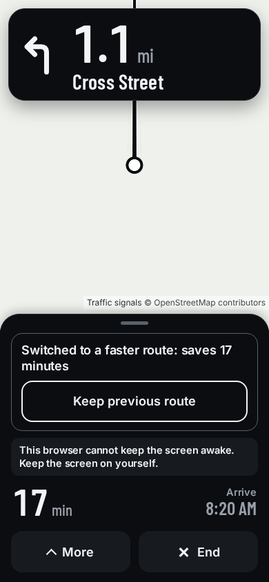
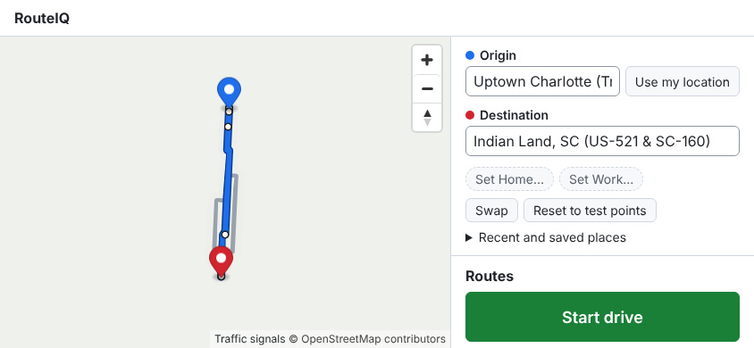
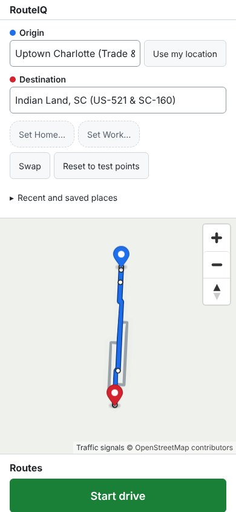
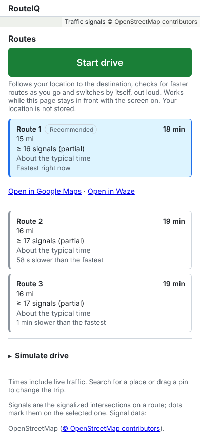
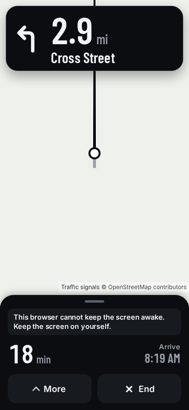
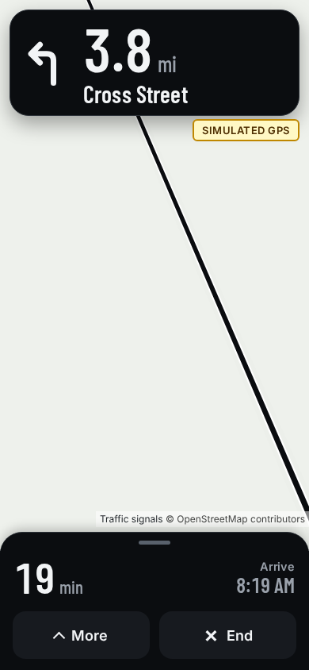
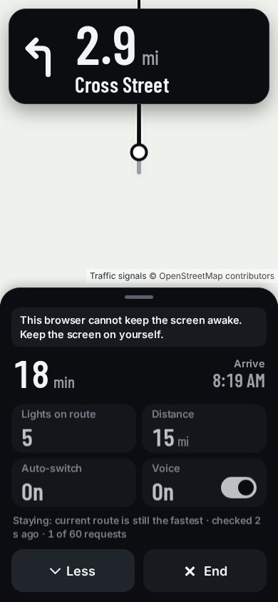

# RouteIQ UX audit: the app as a driver meets it

November 2026, `main` at `2e115ed`. Method: the `ux-review` skill (PR #125). Every screen
and state was photographed with `npm run design:shots` (the production build in headless
Chromium through the offline e2e harness: made-up roads, stubbed GPS, voice and clock, a
blank map style, no token, no network) at 390x844, 430x932 and 844x390 landscape, then
measured in the page: computed text sizes, tap-target boxes, horizontal overflow, and
axe-core 4.14 (`@axe-core/playwright`). Screenshots are 1x and in `docs/design/ux-audit/`;
the Mapbox wordmark is hidden in them and the map is the harness's blank style, so they
contain no third-party map art.

The bar: a driver with the phone in a mount gets what they need in **one glance under two
seconds**, and acts with **one thumb, without looking twice**.

## Summary

The driving screen (#83, PR #106) is already close to the approved design in portrait: the
turn distance is the hero (76 px), two figures at a glance, 60 px controls, no text under
14 px, no horizontal overflow, no serious axe finding with More closed. Where it lets a
driver down is **the moment that matters most, the switch**, and **landscape**. The trip
screen around it is still the prototype's form look.

| # | Impact | Finding | Where it is fixed |
|---|---|---|---|
| 1 | P1 | Landscape: the turn card covers the switch banner and its Keep button; More pushes End off screen; no map is left | #131 |
| 2 | P1 | The pending stage is invisible: a faster route is being confirmed for a minute or more and the screen says nothing | #84 |
| 3 | P1 | The switch banner doesn't tell the story: no before → after, no turn-off distance, words differ from the voice, neutral grey, gone in 8 s | #84 |
| 4 | P2 | A phone in landscape gets the desktop trip screen: 27 to 34 px tap targets | #132 |
| 5 | P2 | The trip screen is the prototype look: light form, 14 px text, green Start, a 12 px Recommended badge, no delta row | #85 |
| 6 | P2 | The wake-lock warning sits in the driving sheet for the whole drive | #133 |
| 7 | P2 | The SIMULATED GPS badge is amber-yellow: amber is reserved for news | #133 |
| 8 | P2 | Voice toggle: accessible name "Mute", visible words "Voice On" (axe serious) | #133 |
| 9 | P2 | The live map is `streets-v12` (light, busy, POIs) under black glass: a torch at night | #47 |
| 10 | P3 | Token rejected: the same error twice on one screen | #85 |
| 11 | P3 | Arrived: "Route requests used: 20" is jargon; the destination pin sits on the attribution | #84 |
| 12 | P3 | Diagnostics is a white sheet over the dark drive | #133 |
| 13 | P3 | No `main` landmark and no `h1` (axe moderate, every screen) | #85 |

## Findings

### 1. P1 · Landscape hides the switch and the map

At 844x390 the turn card (124 px) and the sheet (about 240 px) leave no map. After a switch
the banner grows the sheet upward **under** the turn card: the sentence and the **Keep
previous route** button are covered, so the driver can't read why the route changed or
undo it. With More open the tiles slide under the card (axe reports their labels at
failing contrast because the card overlaps them) and **Less / End are cut off** at the
bottom. Many dash mounts are landscape.

**Fix:** a landscape layout for short screens (`@media (orientation: landscape) and
(max-height: 500px)`): the turn card and the sheet stack in a left column (max 380 px,
inside the safe areas), the map fills the right, so the car and the route ahead stay in
view. The sheet scrolls inside its column if More is taller than the screen.
**Guard:** at 844x390, no driving control or banner is covered by another element
(`elementFromPoint` at its centre) and End is inside the viewport; axe clean.

### 2. P1 · The pending stage is invisible (#84)

The engine waits for a faster route to hold up over two checks (about a minute) before it
switches. During that minute the screen is unchanged; the only trace is the quiet status
line, which is visually hidden with More closed. Then a switch arrives out of nowhere. The
approved design (#22, #43, #44) shows an outlined amber banner, "Checking a faster route /
Would save 8 min · 2 fewer lights" ("lights: can't compare" when partial or unknown), and
a hollow amber marker on the map.

**Fix:** #84. The pending banner, from the engine's own state (`turn.pending`,
`lastDecision.code === 'confirming'`), presentation only.
**Guard:** an e2e scenario that sees the pending banner before the switch, with the saving.

### 3. P1 · The switch banner doesn't tell the story (#84)

- No before → after: the driver can't see that 43 min became 35 min, or the new arrival.
- No turn-off distance on screen, although the voice says "Turn in 3.6 miles".
- The words differ from the voice: screen "Switched to a faster route: saves 17 minutes",
  voice "Switching to a faster route. Saves 17 minutes. Turn in 3.6 miles." Design rule:
  the banner is the spoken sentence, word for word.
- Neutral grey outline: the one moment that is news is not amber.
- "Keep previous route" (approved: **Keep my route**) and no confirmation after pressing
  it (approved: "Staying on your route. / Won't offer that route again for 10 min.").
- It disappears after 8 s (`switchBannerSec`); a driver glancing every 5 to 8 s can miss it.

**Fix:** #84, in the approved design: filled amber banner with the spoken sentence, the old
figures small and struck through beside the new ones (`43 → 35 min`, `10:24 → 10:16`), Keep
my route as the outlined secondary, the kept-route confirmation in calm neutral.
**Guard:** e2e scenarios for pending, confirmed and kept; the banner text equals the
spoken line.

### 4. P2 · Landscape phone gets the desktop trip screen

The phone layout switches on `max-width: 700px`, so an 844 px-wide landscape phone gets the
desktop panel: buttons 27 px high, inputs 34 px, the map zoom controls 32 px, links 17 px.
Measured: 38 controls under 44 px on that screen.

**Fix:** treat a coarse pointer as a phone for sizes:
`@media (max-width: 700px), (pointer: coarse)` for the 44 px rule (layout can stay
side-by-side in landscape).
**Guard:** every control on the trip screen at 844x390 with touch is at least 44 px.

### 5. P2 · The trip screen is still the prototype (#85)

Light GitHub-style form, 14 px text, a green Start drive (a third meaning for colour), a
12 px "Recommended" badge, each route a stack of five grey lines with time at the right.
The approved "Pick a route" (design/exports/merged/merged-2-pick-a-route.png) leads with the
time (large condensed numerals), lights second, distance last, a delta row (−8 min · −2
lights · −3 mi), "Switches by itself if a faster route holds up.", and one white Start.

**Fix:** #85. **Guard:** axe and the 44 px rule on the trip screen; e2e on the delta row
and the three light states.

### 6. P2 · The wake-lock warning lives in the driving sheet

"This browser cannot keep the screen awake. Keep the screen on yourself." is shown for the
whole drive in a browser (not in the iPhone shell, which keeps the screen on). It is the
third thing to read on every glance.

**Fix:** a warning the driver can act on once: show it for the first seconds of the drive,
then keep it behind More. Presentation only; the warnings list stays in core.

### 7. P2 · The simulated-GPS badge borrows amber

Pale yellow with a dark amber border, 13 px. Amber means "a faster route", so a test badge
in amber dilutes it. **Fix:** a neutral raised pill (`--raised`, `--fg`, 14 px, a striped
left edge for "not real"), still always visible for the whole test drive.

### 8. P2 · Voice toggle name doesn't match its words

The button shows "Voice On" but is named "Mute" / "Unmute" (axe: serious,
`label-content-name-mismatch`). A Voice Control user who says "tap Voice" gets nothing.
**Fix:** name it by its words ("Voice", `aria-pressed` for on), or put "Mute" in the label.

### 9. P2 · The live map is a daytime street map

The map style is `mapbox/streets-v12`: light, every POI and label, the same at night next to
black glass (a torch in the driver's eyes), and busy behind the turn card. Can't be judged
here without a token (the harness's map is blank); tracked by #47 with the style note
(dark at night, POIs off while driving, label density down).

### 10–13. P3

- **Token rejected twice** ([screenshot](ux-audit/14-token-rejected-390.png)): the map slot
  and the routes panel both carry the same message. One message, with the fix, in one place.
- **Arrived** ([screenshot](ux-audit/08-arrived-390.png)): "Route requests used: 20" is
  diagnostics, not a driver's sentence; the destination pin lands on the attribution line.
- **Diagnostics** ([screenshot](ux-audit/15-diagnostics-390.png)): a white sheet over the
  dark drive; it is a developer tool but used at home at night too. Dark tokens.
- **Structure:** no `main` landmark and no `h1` on any screen (axe moderate). The trip
  screen should have one `main` and a heading; the drive screen's sheet is its `main`.

## What is already right (keep it)

- Turn card: the distance is the hero (76 px Barlow Condensed), the unit small and dim,
  the street condensed, "Continue straight" in the sentence face (#45).
- Two figures at a glance (turn distance, time left); arrival smaller and dimmer.
- 60 px More / End, at the bottom, one-thumb reach; nothing under 14 px while driving.
- No horizontal overflow at 390, 430 or 844 wide; safe-area insets on every edge.
- Light counts: "≥ 16 data missing" and "Unknown", never 0.
- The once-a-second tick moves nothing (tabular digits, fixed boxes, `contain`).

## Checks that guard this

The design-guards PR adds `e2e/design.spec.ts`: axe on the trip, drive, More and switch
screens; every drive control at least 60 px and everything tapped at least 44 px; no text
under 14 px while driving; no horizontal overflow at 390, 430 and 844 wide; landscape
controls not covered. Each guard is shown failing on a planted regression in its PR.
